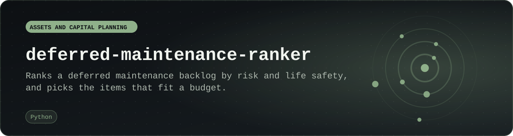
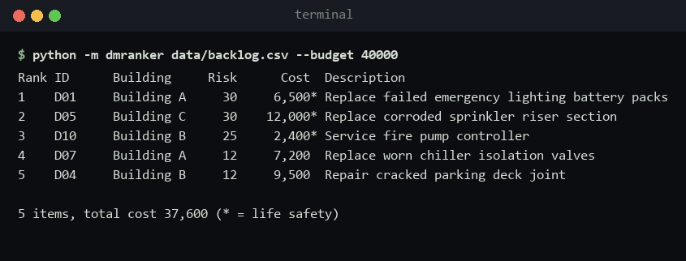

<p align="center"></p>

# deferred-maintenance-ranker

[](https://github.com/yassine2med/deferred-maintenance-ranker/actions/workflows/ci.yml)  

Ranks a deferred maintenance backlog by risk and life safety, and picks the items that fit a budget.



## What it is for

Facility teams carry a backlog of deferred repairs and a budget that never covers all of it. A maintenance planner, facility manager or capital planning lead uses this tool to decide what to fix first. It scores each item by condition and consequence of failure, puts life safety items first, and can pick the items that fit a budget in rank order.

## Install

```
git clone <this repo> && cd deferred-maintenance-ranker
python -m pip install -e .
python -m pytest -q
```

## How to use

| I want to | Command |
| --- | --- |
| Rank the whole backlog | `python -m dmranker data/backlog.csv` |
| Rank and show only the items that fit a budget | `python -m dmranker data/backlog.csv --budget 40000` |
| See all options | `python -m dmranker --help` |

Input columns: id, building, description, condition (1 to 5), consequence (1 to 5), cost, life_safety (yes or no). Items marked `*` in the cost column are life safety.

Worked example:

```
python -m dmranker data/backlog.csv --budget 40000
```

Output:

```
Rank ID      Building     Risk      Cost  Description
1    D01     Building A     30     6,500* Replace failed emergency lighting battery packs
2    D05     Building C     30    12,000* Replace corroded sprinkler riser section
3    D10     Building B     25     2,400* Service fire pump controller
4    D07     Building A     12     7,200  Replace worn chiller isolation valves
5    D04     Building B     12     9,500  Repair cracked parking deck joint

5 items, total cost 37,600 (* = life safety)
```

## How it works

- Risk = condition x consequence, plus 10 when the item is life safety.
- Priority = risk points per 1,000 dollars of cost.
- Ranking order: life safety first, then higher risk, then higher priority, then lower cost.
- With --budget, items are taken in rank order while they fit. An item that does not fit is skipped and cheaper items below it can still be chosen.
- Bad rows (scores outside 1 to 5, cost of zero or less, unknown life_safety value, missing columns) stop the run with a clear message.

## Limits

- The scoring weights are simple and fixed. It is a sorting aid, not a condition assessment.
- The budget pick is greedy, not an optimal knapsack.
- Data is a CSV file only. The sample data is invented.

## License

MIT. Yassine Emhamed, 2026.
